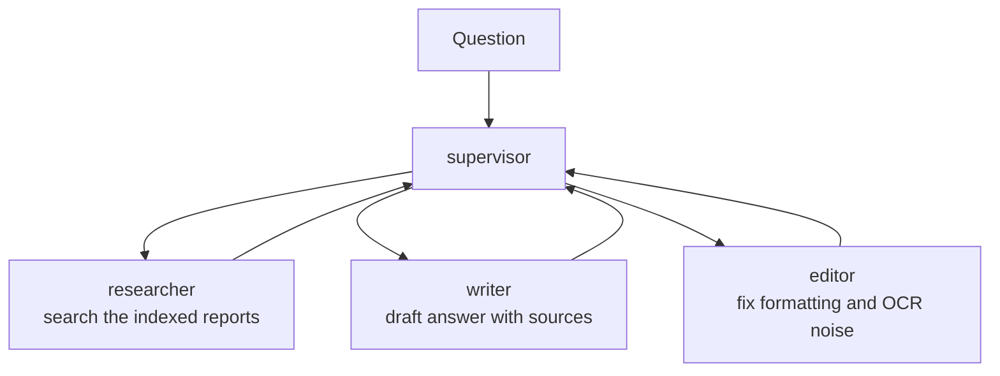

# Market Intelligence Multi-agent

A supervisor-led team of agents (researcher, writer, editor) answers market analysts' questions about a competitor's financial reports, citing the source sections.

**Stack:** Python · LangGraph · Azure OpenAI (GPT-4.1) · Azure AI Search · Azure Document Intelligence · Streamlit
**Role:** Lead developer: design and implementation

> Built at a large Brazilian insurer. The company is replaced by the fictional **Acme Seguros** (the competitor by the fictional **Beta Seguros**), and every name, document and data point here is fictional. Code, prompts and UI are in Portuguese, written for Brazilian business teams.

## Problem

Analysts read quarterly and annual reports from competitors (financial statements, earnings releases) to answer recurring questions about results and strategy. The documents are long, unstructured and often come through OCR with broken tables and formatting.

## What I built



- **Hierarchical multi-agent graph:** the supervisor decides which specialist acts next and when the answer is ready.
- **Time-aware answers:** when a question gives no period, the agents assume the most recent year in the corpus.
- **Output clean-up:** fixes OCR artefacts and escapes characters that break Streamlit's Markdown (such as `$` in currency values).
- **Ingestion** of PDFs and Markdown into the search index, section by section.

## Run it

```bash
python -m venv .venv && .venv\Scripts\activate   # macOS/Linux: source .venv/bin/activate
pip install -r requirements.txt
cp .env.example .env                               # Azure OpenAI + AI Search
streamlit run streamlit_app.py
```

Needs an index with your own sample reports.

---
Part of my [AI engineering portfolio](https://github.com/lucasboliveirasipp).
